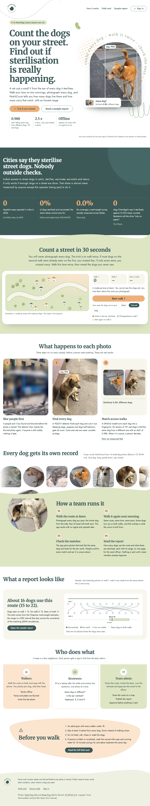
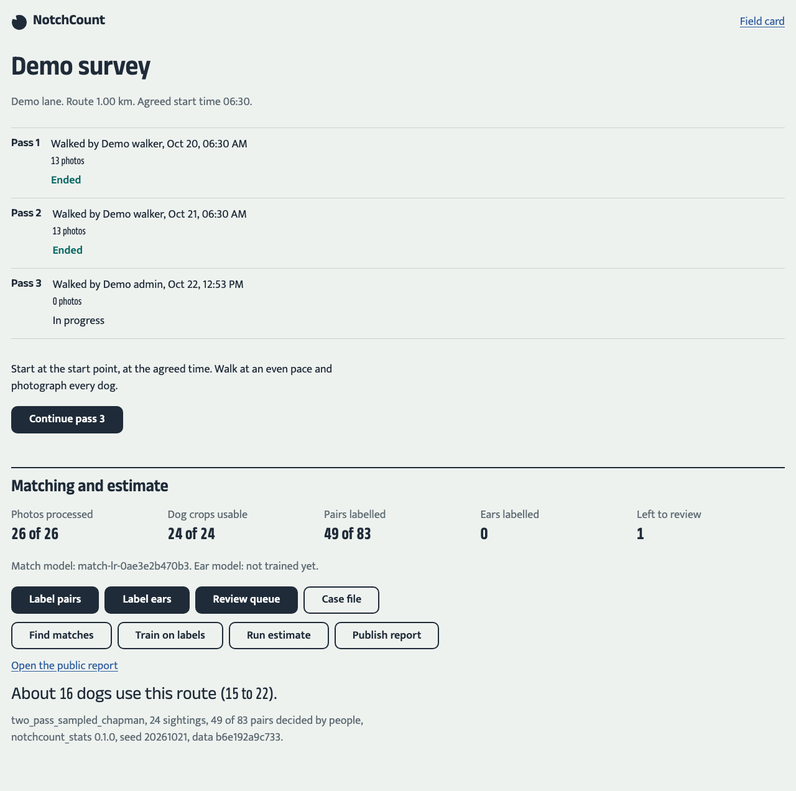
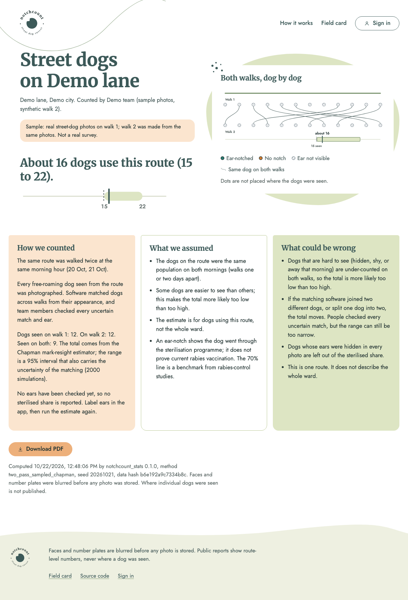
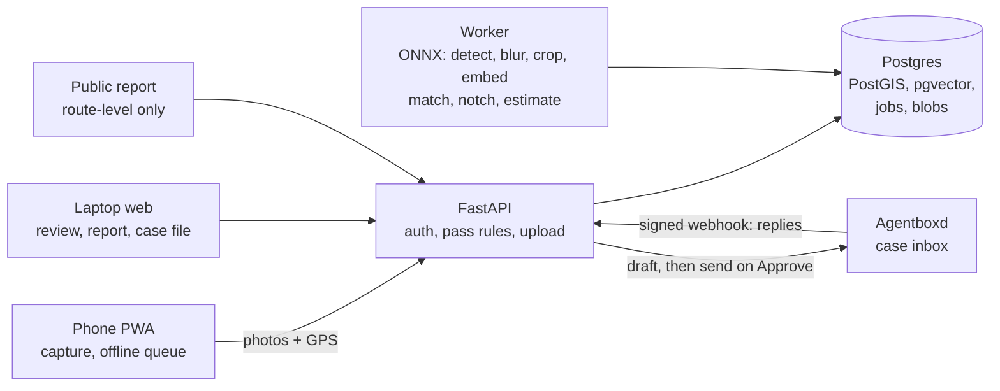

# NotchCount

Two walks down a street become a statistically valid audit of street-dog sterilisation coverage.

India's Animal Birth Control programme catches, sterilises, vaccinates and ear-notches street dogs, then returns them. Whether it works depends on coverage, and nobody outside the operator measures coverage. With NotchCount, residents photograph every free-roaming dog on a fixed route on two mornings. The app recognises the same dog across both walks, checks each ear for the notch a vet cuts at sterilisation, and estimates how many dogs use the route and what share are sterilised, with honest ranges. It then files a one-page evidence report with the official responsible. A team member approves every email before it is sent.

**Our route:** _[filled in by the team from the final report: dates, route length, estimate with range, sterilised share with range]._ Live app: https://notchcount.deployxa.online (backup: https://notchcount.onrender.com; see [DECISIONS D-30](docs/DECISIONS.md)).

## Screens

| Landing | Survey dashboard | Public report |
|---|---|---|
|  |  |  |

Every screen at 375 px and 1280 px is in [`docs/screens/`](docs/screens/), each with an overflow and accessibility audit (`audit-*.json`). The screenshots come from the live demo team, whose walk 1 is real street-dog photos and whose walk 2 is synthetic (the same photos re-shot by transforms). The visual direction follows the team's reference ([DECISIONS D-25](docs/DECISIONS.md)).

## Quick start

Needs Python 3.12 with [uv](https://docs.astral.sh/uv/), Node 24 with pnpm, and a Postgres that has PostGIS and pgvector (Supabase works).

```bash
git clone https://github.com/rahulgunwanistudy-2005/NotchCount && cd NotchCount
uv sync
cd apps/web && pnpm install && cd ../..
cp .env.example .env              # set NC_DATABASE_URL and two random secrets
make migrate                      # creates the `notchcount` schema tables
uv run python models/download.py  # ONNX detector and embedder, checksum-verified
uv run nc-admin bootstrap --team "My street" --city "Delhi" --admin "Asha"   # prints a sign-in link
make build-web && make dev-api    # app and API on http://localhost:8000
make worker                       # in a second terminal: processes photos
make check                        # lint, types, unit tests, web build
cd apps/web && pnpm run test:ui   # interface tests on the built site, API mocked
```

Database tests (`make test-db`) need `NC_DATABASE_URL` and run in a separate `notchcount_test` schema.

## How it fits together



| Module | Does | Never does |
|---|---|---|
| `packages/notchcount_stats` | Chapman, Chao log-normal interval, Wilson, Schnabel, sampling over match and ear uncertainty | Any I/O |
| `packages/pipeline` | Detect, blur, crop, embed, candidate pairs, match model, ear model, assignment | HTTP or database |
| `services/api` | Thin FastAPI routes, auth, pass-integrity rules, filing gate, public report and PDF | Model inference |
| `services/worker` | Postgres job queue (`FOR UPDATE SKIP LOCKED`): ingest, match, train, estimate | Serve HTTP |
| `apps/web` | SvelteKit PWA: capture, labelling, review, report, case file | Hold secrets |
| `sim` | Synthetic surveys with a known truth through the same estimator | Touch real data |

More in [`docs/ARCHITECTURE.md`](docs/ARCHITECTURE.md).

## The method

**In plain words.** On walk 1 we photograph every dog. On walk 2, the next morning, we do it again. Some dogs are photographed both times. If most dogs from walk 2 were already seen on walk 1, few dogs were missed; if only a few were, many were missed. That ratio gives the total. Each dog's ear tells us whether it was sterilised. The software matches dogs between walks from their appearance, and people check every match it is unsure about.

**The maths.** With n1 and n2 dogs seen on each walk and m2 seen on both, the Chapman estimate is N̂ = (n1+1)(n2+1)/(m2+1) − 1. The 95% interval is Chao's log-normal interval, which never goes below the number of dogs actually seen. Matching is uncertain, so every candidate pair carries a calibrated probability of being the same dog. The estimator draws 2000 plausible matchings. In each, every walk-2 dog chooses one walk-1 candidate or "not seen before", weighted by how much more its score looks like a true match than a look-alike ([D-21](docs/DECISIONS.md)). For each matching it draws the population and the sterilised share (Jeffreys Beta). The reported range covers all of that. Details: [`docs/BIBLE.md` §3](docs/BIBLE.md).

**Does it work?**
- **Simulation.** On 1000 simulated surveys per scenario ([`docs/ESTIMATOR_VALIDATION.md`](docs/ESTIMATOR_VALIDATION.md)), 95% intervals covered the true count 93% of the time with perfect matching. With 5% of matches made wrongly they covered 92.3%, within simulation noise of the target. With 5% of true matches looking like strangers they covered 90.8%, about 2 points short, and we say why.
- **Matching on real photos.** On real photos of known dogs ([`docs/REID_BENCHMARK.md`](docs/REID_BENCHMARK.md)), the embedder told same-dog pairs from different-dog pairs with AUC 0.988 for whole dogs and 0.993 for faces.
- **End to end.** Real photos with a known truth went through the whole pipeline, and the counts came out exact ([`docs/ENGINE_CHECK.md`](docs/ENGINE_CHECK.md)).
- **Still to come.** The matcher and ear model's accuracy on the team's own labels goes in [`docs/MODEL_REPORT.md`](docs/MODEL_REPORT.md) _(after labelling)_.

## Privacy and data handling

- People and vehicles are detected and blurred **before** any image is stored. The detector then runs again on the blurred image, and if a person is still visible, nothing from that photo is stored. EXIF is stripped.
- Unblurred originals sit in a private quarantine area and are deleted once the blurred copy exists. Images are served only through signed links that expire after 5 minutes.
- The public report shows route-level numbers. Its dot strip is deliberately not placed where dogs were seen. Individual dog locations appear only in the team's own view.
- No phone numbers or emails of walkers are stored for the interim sign-in, only a display name. Each walker signs in with a one-time link.
- Stored: blurred photos, dog crops, detections, labels, estimates, case emails. To delete a team's data, delete its row in `teams`; everything team-owned cascades.

## Sponsor tech

- **Agentboxd**: one inbox per case (`client_id = case-<id>`). Drafts are created with a draft-only key. Only the Approve button (team admin) sends, with the content hash pinned. Replies arrive by signed webhook, from whichever of the received, screened or released events first carries the text, and are stored as untrusted text; flagged ones are held. No model reads them. The admin System health page checks both keys live.
- **MojoAuth**: sign-in by emailed one-time code, beside the one-time invite links ([D-28](docs/DECISIONS.md)). A team admin adds a person's email, or a signed-in walker adds their own. Only a keyed hash of the address is stored. Phone codes use the same API shape.
- **Deployxa**: hosts the app at https://notchcount.deployxa.online, built from this repository's Dockerfile. Render runs the same image as a backup, on the same database. The web service also runs the job worker ([D-26](docs/DECISIONS.md)), so photos are processed without the team laptop; the laptop worker is faster and can run alongside.
- Backboard, Spine and Momen are not used: none of them does a job this product needs, and adding them for show would make the system harder to explain and audit.

## Limitations

See [`docs/LIMITATIONS.md`](docs/LIMITATIONS.md). The main ones: dogs differ in how easy they are to see, so the total leans low. Interval coverage falls short when matching is uncertain. The estimate covers the route, not the ward.

## Team, AI use, licence, credits

- Team: _[names and roles]_. AI assistance is disclosed in [`docs/AI_DISCLOSURE.md`](docs/AI_DISCLOSURE.md).
- Licence: AGPL-3.0 ([LICENSE](LICENSE)).
- Models: Ultralytics YOLO11s (AGPL-3.0); DINOv2 ViT-S/14 by Meta AI (Apache-2.0).
- Fonts: Merriweather, Jost and Mukta (SIL OFL 1.1), self-hosted.
- Visual reference: "Cub Club Site and Dashboard" by Julia Pelachini Farias (DR Studio) on Dribbble. We followed its visual language; no assets were copied.
- Landing photos: "Street Dog 100" and "Street Dog 105" by Slyronit, Wikimedia Commons, CC BY-SA 4.0, cropped.
- Maps: [OpenFreeMap](https://openfreemap.org), © OpenMapTiles, data © OpenStreetMap contributors.
- Test photos: Wikimedia Commons, CC BY-SA 4.0 (see `packages/pipeline/tests/CREDITS.md`).
- Design process: Anthropic's frontend-design skill. Mobbin was not used (paid plan needed, [D-27](docs/DECISIONS.md)).
