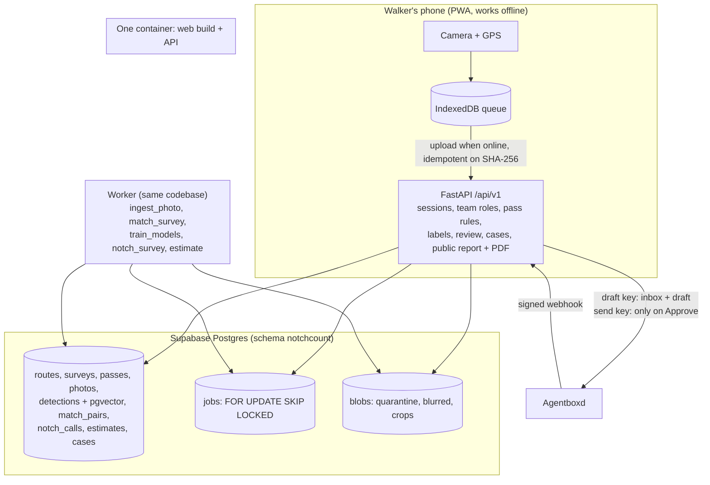

# Architecture

## Life of a photo

1. **Shutter.** The frame is resized to a 1600 px long edge and saved as JPEG at q 0.85. It is hashed (SHA-256) and stored in IndexedDB with time, GPS, accuracy and shot type (side or head). After an 8-second undo window it becomes eligible to upload.
2. **Upload** (`POST /passes/{id}/photos`). The API checks the session, team, that this walker owns the pass, the JPEG magic bytes, that the hash matches, the pass time window, and the route corridor (PostGIS `ST_DWithin`). GPS problems are flags, never drops. The original goes into the `quarantine` bucket and an `ingest_photo` job is queued. Repeating the upload returns the same photo.
3. **Ingest** (worker). Decode, apply EXIF rotation, drop EXIF. YOLO11s finds dogs, people and vehicles. People and vehicles are pixelated and blurred, and the detector runs again to prove no person is left visible. Each dog is cropped, scored for size, sharpness and truncation, and embedded with DINOv2, plus an HSV colour histogram. The blurred photo and crops are stored and the original is deleted.
4. **Match** (`match_survey`). Candidate pairs come from time, distance along the route (`ST_LineLocatePoint`) and cosine similarity. Each gets features and P(same) from the team's logistic model, or from a marked uncalibrated prior before any labels exist.
5. **People.** Labelling screens collect pairs and ears (stratified by similarity band). The review queue shows uncertain pairs, cross-pass first, then uncertain ears. Every answer is kept; agreement decides.
6. **Estimate** (`estimate`). The job checks that the passes are comparable (same route, start window, different mornings). It then runs `notchcount_stats.estimate_two_pass` (B = 2000, seeded), or single-pass mode. Results, data hash, code version and git SHA are stored. Proposed individuals come from within-pass clustering plus Hungarian assignment.
7. **Report and filing.** The public report and PDF read only the stored estimate. A case drafts an email through Agentboxd, and only a team admin's Approve sends it.

## Boundaries that tests hold

- `notchcount_stats` has no I/O (it is imported by the simulator and the worker alike).
- `pipeline` has no HTTP and no database; the worker does the I/O around it.
- API handlers are thin; rules live in `domain/integrity.py` and `reporting.py`.
- Every team-owned query filters by the caller's membership (tested: another team gets 404).
- The send key is used in exactly one function, `approve_and_send`.
