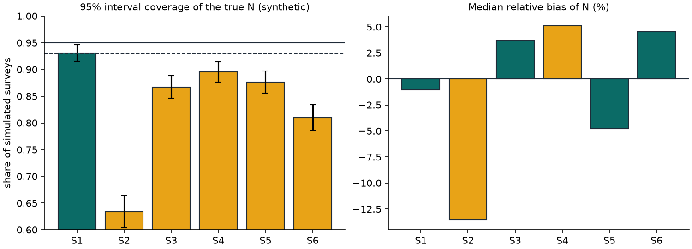

# Estimator validation (synthetic data)

**Everything on this page comes from simulated surveys with a known true population. No real dog is described here.** The simulator (`sim/model.py`) feeds the same `notchcount_stats` code that runs on real data.

Generated by `uv run python -m sim.run`: 1000 replicates per scenario, 400 sampler draws per replicate (the production default is 2000; percentile intervals are stable at this size), `notchcount_stats` 0.1.0, 3.9 minutes on 8 cores. Seeds are fixed, so rerunning gives identical numbers.

| Scenario | N | Capture p | Heterogeneity | False split (realised) | False merge (realised) | Matcher uncertainty used | Coverage of N (95% MC band) | Median bias of N | Median interval width | Coverage of share | No estimate |
|---|---|---|---|---|---|---|---|---|---|---|---|
| S1 | 60 | 0.6 | none | 0.000 | 0.000 | yes | 0.931 ± 0.016 | -1.0% | 19.8 | 1.000 | 0.0% |
| S2 | 60 | 0.6 | Beta(2.0, 1.33) | 0.000 | 0.000 | yes | 0.634 ± 0.030 | -13.6% | 13.2 | 0.998 | 0.0% |
| S3 | 60 | 0.6 | none | 0.052 | 0.002 | yes | 0.867 ± 0.021 | +3.7% | 23.8 | 1.000 | 0.0% |
| S4 | 60 | 0.6 | none | 0.006 | 0.044 | yes | 0.895 ± 0.019 | +5.1% | 27.8 | 1.000 | 0.0% |
| S5 | 15 | 0.5 | none | 0.000 | 0.000 | yes | 0.876 ± 0.021 | -4.8% | 12.9 | 0.996 | 1.3% |
| S6 | 60 | 0.6 | none | 0.053 | 0.002 | no | 0.810 ± 0.024 | +4.5% | 23.4 | 0.998 | 0.0% |

Coverage is the share of simulated surveys whose 95% range contained the true N. The band after ± is the Monte Carlo uncertainty of that share. "No estimate" counts surveys where too few dogs were matched to report a population (BIBLE 3.2 and SESSION_PROMPT section 7).

## What this shows

- **S1** (meets 0.93, coverage 0.931). Equal catchability, perfect matching: the reference case. Expected near 0.95; small shortfalls come from the log-normal approximation and the sampler size.
- **S2** (falls below 0.93, coverage 0.634). Dogs differ in how easy they are to see (Beta(2, 1.33) catch probability). Easy dogs are seen in both passes, so recaptures run high and Chapman runs low. This is a property of the two-sample method, not of the code, and it is why the report calls the estimate a likely lower bound.
- **S3** (falls below 0.93, coverage 0.867). Modelling helps (the same matcher with hard decisions, S6, covers less) but does not reach 0.93. Why: an ambiguous true match scores like a decoy, so its calibrated pairwise probability is small (about 0.02 here) and it is rarely drawn. Calibration puts the missing probability on look-alike decoys instead, but the one-to-one repair throws most of that away, because those decoys' pass-2 dogs already have clear matches. So m2 runs low and N runs high. The fix is an assignment-level model (each pass-2 dog picks one candidate or none, with the recapture rate estimated jointly). It is not implemented yet; see docs/LIMITATIONS.md.
- **S4** (falls below 0.93, coverage 0.895). A look-alike scored above 0.5 can win the one-to-one repair and push out the true partner, so a wrong merge often costs a right one. Net m2 falls and N rises, the opposite of what one wrong merge alone would do. The sampler sometimes rejects the look-alike, which widens the range, but not enough.
- **S5** (falls below 0.93, coverage 0.876). Few recaptures: the Chapman variance and the log-normal interval are rough at small m2, so coverage drops and ranges are wide. Some surveys have too few matches to estimate at all.
- **S6** (falls below 0.93, coverage 0.810). The same matcher as S3, but every pair is decided at 0.5 and fed to plain Chapman. Missed matches lower m2 and inflate N, and the interval knows nothing about it. This is what NotchCount would report without the sampler.

## Limits of this validation

- The simulated matcher is calibrated by construction. The real matcher is a logistic model fitted to the team's labelled pairs (`docs/MODEL_REPORT.md`); if it is miscalibrated, real coverage will be worse than S3 and S4.
- Each dog appears at most once per pass here. Real passes have side and head shots and repeat sightings, which the within-pass clustering must group correctly.
- Notch calls are perfect apart from hidden ears. Real notch calls go through a classifier and human review.

Raw numbers: `docs/estimator_validation.json`.
